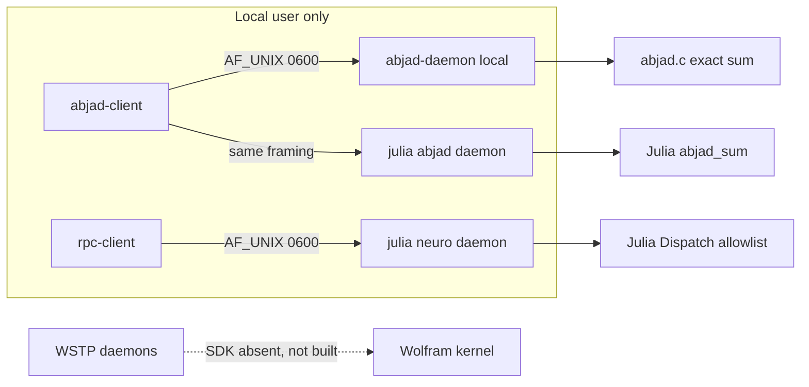

<!-- SPDX-License-Identifier: AGPL-3.0-only -->
<!-- SPDX-FileCopyrightText: 2026 The algorithm-cores project contributors -->

# Abjad-elliptic-soyga

[](LICENSE)
[](https://github.com/AHMADALIPARR/Abjad-elliptic-soyga/actions/workflows/ci.yml)

Elliptic curves, Eastern abjad totals, the Soyga recurrence, and the Dee Mirror square. Four numerical programs, each left in the language it was started in, plus a Julia stand-in where a proprietary Wolfram kernel is required and not available.

## Repository

```sh
git clone https://github.com/AHMADALIPARR/Abjad-elliptic-soyga.git
cd Abjad-elliptic-soyga
```

The review branch for this source import is [`cursor/import-algorithm-sources-8bd2`](https://github.com/AHMADALIPARR/Abjad-elliptic-soyga/tree/cursor/import-algorithm-sources-8bd2). The review pull request is https://github.com/AHMADALIPARR/Abjad-elliptic-soyga/pull/1 .

The CI badge above reads the workflow on the default branch. It is a link to the Actions runs. It is not, by itself, a statement that a hosted run has passed. The pull request checks are the run for this branch. Wolfram Language and WSTP are not part of that workflow.

The tree was imported from the completed source archive of private development commit `a9118ffda6fec90e8c4eb2c824f87e6b3254bf78`. `originals/MANIFEST.sha256` still checks the unmodified starter members. `LICENSE` is the verbatim GNU AGPL version 3 already on this repository, not a reformatted copy.

| Piece | Language | Role |
| --- | --- | --- |
| `abjad-wstp` | C, Wolfram source | Eastern abjad totals over a local Unix socket |
| `elliptic-neuroregex` | C, Wolfram source | Group-valued 3×3 square, integral curve points, lexical search |
| `mirror-bqn` | BQN | Odd-order torsion square and the finite-field group law |
| `soyga-agda` | Agda | Machine-checked Soyga recurrence |
| `julia` | Julia | Second implementations, both socket servers, tests |

The license for project-owned source is **AGPL-3.0-only** (GNU Affero General Public License version 3 only, not “or any later version”). The verbatim text is [`LICENSE`](LICENSE). Copyright 2007 of that license document is the Free Software Foundation’s. Third-party tools are not relicensed; see [`NOTICE`](NOTICE) and [`docs/FILE_AUDIT.md`](docs/FILE_AUDIT.md).

`originals/` and `uploads/` are the starter bytes. They had no license. They are not edited to apply this one.

## Architecture



Nothing in the default build listens on TCP. Clients cannot send Wolfram source or a shell command. The WSTP C files remain in the tree and are not linked here.

Two magic squares are implemented and they are not the same square:

- NeuroRegex / Julia `magic_z3`: `M(i,j) = (i+j, j)` in `(Z/3Z)^2`.
- BQN `Magic`: `G(r,c) = (c+r, c+2r) mod n` for odd `n`.

Abjad, Soyga, both squares, and the elliptic group law are exact. NeuroRegex scores use binary64 weights `0.35` and `0.12`. Integral points are exhaustive only inside a stated bound.

## Setup

The timings in `benchmarks/` were measured on 2026-11-07 and are stored as the command output from that run. `benchmarks/environment.txt` records the host. Later clones do not rewrite those files. A fresh `./scripts/test-all.sh` checks correctness again. It does not replace the stored samples.

Recorded toolchain, from `benchmarks/environment.txt` (2026-11-07):

| Tool | Version used |
| --- | --- |
| GCC | 13.3.0, `-std=c11 -Wall -Wextra -Werror` |
| Julia | 1.11.6 |
| Agda | 2.6.3 |
| CBQN | built from commit `588753c` with `make REPLXX=0` |
| OS | Linux 6.12.113, 4× Intel Xeon |

`wolframscript` and `WolframKernel` were not installed. Do not read a passing test as a Wolfram run.

### C

```sh
make -C abjad-wstp
make -C abjad-wstp test
make -C elliptic-neuroregex test-native
```

`make -C abjad-wstp wstp` and `make -C elliptic-neuroregex wstp-daemon` stop until you pass a real WSTP SDK. This tree does not.

### BQN

Install [CBQN](https://github.com/dzaima/CBQN) as `bqn` (`make REPLXX=0` if you have no C++ standard library headers). Then:

```sh
bqn mirror-bqn/test.bqn
bqn mirror-bqn/test_more.bqn
bqn mirror-bqn/demo.bqn
```

### Agda

```sh
cd soyga-agda && agda --safe --without-K Soyga.agda
```

Run it from `soyga-agda/` so the module name matches the file. No standard library is required. The file sets `--safe` and `--without-K`. It has no postulates and no termination pragma.

### Julia

```sh
julia --project=julia --startup-file=no -e 'using Pkg; Pkg.test("Algorithms")'
julia --project=julia --startup-file=no julia/bin/abjad_daemon.jl /tmp/abjad.sock
julia --project=julia --startup-file=no julia/bin/neuro_daemon.jl /tmp/neuro.sock
```

Dependencies in `julia/Project.toml` are Julia standard libraries only (Printf, Sockets). Test uses the Test standard library. No third-party Julia package is vendored.

### Everything

```sh
./scripts/test-all.sh
./scripts/examples.sh
```

`scripts/examples.sh` rewrites `examples/e2e.txt`. The copy in the repository is the transcript from the recorded run.

### CI

[`.github/workflows/ci.yml`](.github/workflows/ci.yml) runs, on GitHub-hosted Ubuntu:

- `make -C abjad-wstp test` and `make -C elliptic-neuroregex test-native`, with GCC
- the two `make wstp` targets, which must exit because no WSTP SDK is configured
- CBQN built from commit `588753c` with `make REPLXX=0`, then `mirror-bqn/test.bqn` and `mirror-bqn/test_more.bqn`
- `agda --safe --without-K Soyga.agda` using the distribution Agda package
- Julia 1.11.6 from the upstream tarball, then `Pkg.test("Algorithms")`

The workflow is shell and the existing Make files. It does not install Python and it does not add another implementation language. It does not run `wolframscript` or `tests/test.wls`. Hosted success is whatever the Actions page shows for a given commit. This README does not substitute for that page.

## Examples that were run

Abjad, Eastern kabir, from `examples/e2e.txt`:

| Input | Total |
| --- | --- |
| `الله` | 66 |
| `محمد` | 92 |
| `أحمد` | 53 |
| `علي` | 110 |
| the 28 abjad letters | 5995 |

`أ إ آ ٱ` count as alif. `ى` counts as ya. `ة` counts as ha. Hamza, tatweel, and harakat add nothing. A string with no valued letter is rejected. Broken UTF-8 is rejected.

Soyga, seed `nisram`, first row from the same example file:

```text
ndizbdizbdizbdizbdizbdizbdizbdizbdiz
```

BQN, curve `y² = x³ + 2x + 3` over `F_97`, repeated addition of `(3,6)`:

```text
(3,6), (80,10), (80,87), (3,91), O
```

`5·(3,6) = O`. Over `F_5`, `y² = x³ + 1`, `2·(0,1) = (0,4)` and `3·(0,1) = O`. Integral points of `y² = x³ + 1` with bound 4 are `(-1,0)`, `(0,±1)`, `(2,±3)`.

NeuroRegex magic dispatch returned `{"valid":true,"distinct":true}` with eight line sums `(0,0)`. That was the Julia dispatcher, not Wolfram.

## What Julia replaces

Julia does not replace BQN, Agda, or the C abjad decoder. It provides:

- a second abjad decoder, checked against the C totals and callable as a Unix-socket daemon the C client already speaks
- the elliptic group law, integral-point search, and NeuroRegex index, which otherwise live only in `NeuroRegex.wl`
- a Unix-socket server for the C `rpc-client`
- the property tests and the benchmark driver

`wolfram.c` and `wstp_daemon.c` are still the WSTP integrations. They were not compiled against WSTP and were not run against a kernel.

## Tests and timings

The stored log is `benchmarks/verification.txt`, from `./scripts/test-all.sh` on 2026-11-07, exit 0. That file is the record of the run that produced the benchmark samples. It was not rewritten during the GitHub import.

The same command was run again on this import, on 2026-11-07, and exited 0. Observed tools: GCC 13.3.0, Julia 1.11.6, Agda 2.6.3 (`2.6.3-1build1`), CBQN commit `588753c8`. Observed results: smoke PASS and `abjad suite checks=924 failures=0`; the original group-square PASS line and `elliptic native checks=26 failures=0`; `bqn mirror-bqn/test.bqn` printed `All Dee Mirror BQN assertions passed`; `bqn mirror-bqn/test_more.bqn` printed `BQN extended tests passed: 40`; `agda --safe --without-K Soyga.agda` printed `Checking Soyga` and exited 0; `Pkg.test("Algorithms")` passed 842 tests (JSON 9, Abjad 421, elliptic 324, Soyga 45, NeuroRegex 33, RPC 10). `wolframscript` and `WolframKernel` were not on `PATH`. `make -C abjad-wstp wstp` and `make -C elliptic-neuroregex wstp-daemon` both stopped and asked for WSTP paths. The line `RPC error: 1` in the Julia log is the C client rejecting a bad input inside a test that expects that rejection.

| Check | Printed result |
| --- | --- |
| `make -C abjad-wstp test` | smoke PASS; `abjad suite checks=924 failures=0` |
| `make -C elliptic-neuroregex test-native` | original group-square PASS; `elliptic native checks=26 failures=0` |
| `bqn mirror-bqn/test.bqn` | 11 assertions passed |
| `bqn mirror-bqn/test_more.bqn` | `BQN extended tests passed: 40` |
| `agda --safe --without-K Soyga.agda` | exit 0, `Checking Soyga` |
| `Pkg.test("Algorithms")` | 842 passed: JSON 9, Abjad 421, elliptic 324, Soyga 45, NeuroRegex 33, RPC 10 |

The Julia elliptic set includes commutativity, inverses, and associativity for every triple of the six points of `y² = x³ + 1` over `F_5`, including the point at infinity. That is a finite check, not a general theorem. The Agda file is the only machine-checked proof, and it is about the Soyga step, not about elliptic curves.

Timings in `benchmarks/`, host as in `benchmarks/environment.txt`, UTC 2026-11-07T21:02:42Z:

- C `abjad_sum`, 200 repetitions, 4096 bytes of alif: min 8229 ns, mean 11181.8 ns, max 26737 ns (`benchmarks/abjad-c-raw.txt`).
- Julia samples, including 30 repetitions of an 8000-letter abjad sum (about 27–38 µs), are the raw lines in `benchmarks/julia-raw.txt`.
- BQN `•MonoTime`, 20 repetitions of `VerifyMagic 9` and one scalar multiplication (`benchmarks/bqn-raw.txt`). Those durations sit on the timer floor (about 3e-8 to 2e-7 s). They show the calls return; they are not a throughput claim.

`examples/e2e.txt` is the end-to-end transcript.

## Limits

- No Wolfram validation. `tests/test.wls` was not executed.
- Sockets are filesystem Unix sockets, mode `0600`, one client at a time, 5 s default timeout, Abjad payload ≤ 65536 bytes, NeuroRegex payload ≤ 1 MiB. There is no authentication beyond the file mode and no TCP listener.
- Regex uses PCRE2 with match limit 100000 and depth limit 10000, not Wolfram `TimeConstrained`. A pattern that fails those limits does not match.
- BQN `CurvePoints` allows primes up to 256. `Trace` fuel is at most 1024. `Magic` allows odd `n` from 1 to 401.
- The C curve helper is int64 and returns an error on overflow. Julia uses `BigInt`.
- NISRAM letter counts from the recurrence are B 72, R 70, Y 70. MARSIN counts are I 82, T 72, Y 67. The fourth-row cycle is `qsrnplfdfzly`. A secondary transcription says `qsrnylfdfzly`. Rows 11, 22, and 33 are not all L. Those two secondary claims are not asserted.
- `SquareOfSquaresQ` only rejects or accepts a candidate. It does not produce a 3×3 magic square of distinct positive squares.
- This is not a cryptographic primitive and not a certification.

## Layout

```text
LICENSE                  AGPL-3.0 verbatim
NOTICE                   third-party notices
docs/ALGORITHMS.md       definitions and vectors
docs/SECURITY.md         socket and resource limits
docs/FILE_AUDIT.md       every file, license class
docs/STUB_LEDGER.md      starter gap to code or blocker
originals/               unmodified starter members plus checksums
uploads/                 the four zip archives
```

File-by-file classes and the exceptions to inline SPDX headers are in [`docs/FILE_AUDIT.md`](docs/FILE_AUDIT.md).
