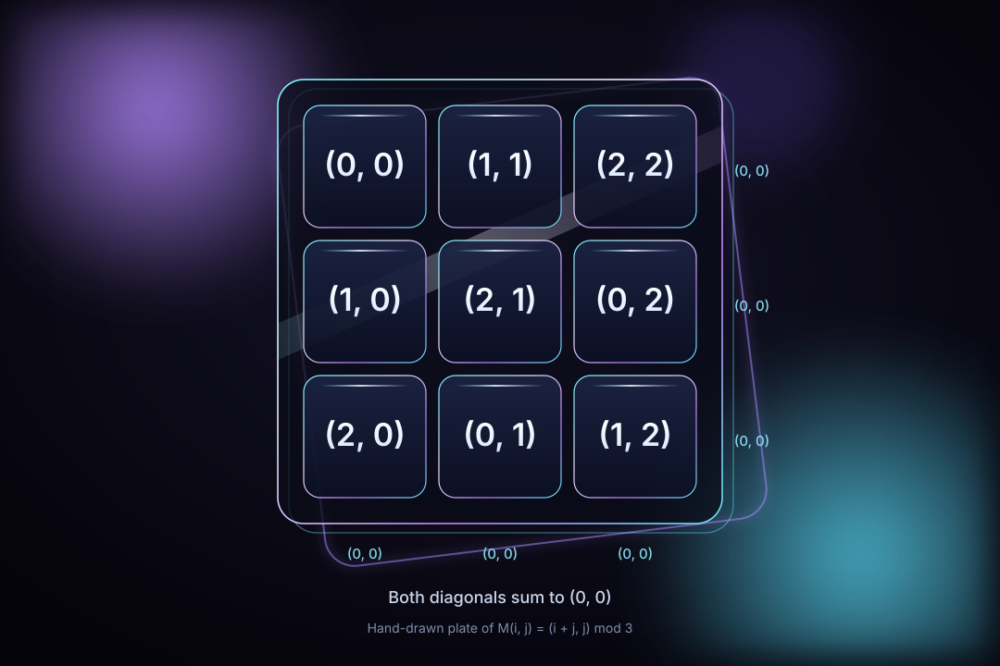

<!-- SPDX-License-Identifier: AGPL-3.0-only -->
<!-- SPDX-FileCopyrightText: 2026 The algorithm-cores project contributors -->

# Abjad-elliptic-soyga

[](LICENSE)
[](https://github.com/AHMADALIPARR/Abjad-elliptic-soyga/actions/workflows/ci.yml)

Exact arithmetic for an Eastern abjad, a Soyga table, a finite-field curve, and two different group-valued squares. Each piece stays in the language it started in. Julia stands in where a Wolfram kernel is required and is not available.

<p align="center">
  
</p>

The plate is a drawing of `magic_z3`, the same square `MagicTorsionSquare` describes: `M(i, j) = (i + j, j)` in `(Z/3Z)^2`. All nine cells are distinct. Every row, column, and both diagonals sum to `(0, 0)`. Julia `magic_certificate` returned `true` for this square on 2026-11-07. The SVG is hand-drawn. The programs print the cells and the certificate. They do not paint this picture.

That square is not the BQN square, and it is not the Lo Shu square of integers 1 through 9.

| Square | Where it lives | Line sum |
| --- | --- | --- |
| `M(i, j) = (i + j, j)` | Julia `magic_z3`, Wolfram `MagicTorsionSquare`, the plate above | `(0, 0)` in `(Z/3Z)^2` |
| `G(r, c) = (c + r, c + 2r)` for odd `n` | BQN `Magic` | `(0, 0)` in `(Z/nZ)^2` |
| Lo Shu `8 1 6 / 3 5 7 / 4 9 2` | Accepted by `square_sums` as a test vector | `15` on every line |

`square_of_squares` returns false for the Lo Shu square. The repository checks a candidate. It does not search for a 3×3 magic square of distinct positive squares.

## What you can run

```sh
git clone https://github.com/AHMADALIPARR/Abjad-elliptic-soyga.git
cd Abjad-elliptic-soyga
```

| Tool | Used for | Recorded version |
| --- | --- | --- |
| GCC | C daemons and native tests | 13.3.0, `-std=c11 -Wall -Wextra -Werror` |
| [CBQN](https://github.com/dzaima/CBQN) | `mirror-bqn` | commit `588753c`, `make REPLXX=0` |
| Agda | `soyga-agda/Soyga.agda` | 2.6.3, `--safe --without-K` |
| Julia | package `Algorithms` | 1.11.6, standard libraries only |
| Wolfram / WSTP | `*.wl`, `wolfram.c`, `wstp_daemon.c` | not installed here |

Nothing in the default build listens on TCP. Sockets are `AF_UNIX` with mode `0600`.

### Abjad

```sh
make -C abjad-wstp
./abjad-wstp/abjad-daemon local /tmp/abjad.sock &
./abjad-wstp/abjad-client /tmp/abjad.sock 'الله'
```

That client command printed `66`. `محمد` printed `92`. The same totals are in `examples/e2e.txt`, along with `أحمد` = 53 and `علي` = 110. The 28 letters `ابجد هوز حطي كلمن سعفص قرشت ثخذ ضظغ` total 5995. `أ إ آ ٱ` count as alif, `ى` as ya, `ة` as ha. Hamza, tatweel, and harakat add nothing. A string with no valued letter is rejected. Broken UTF-8 is rejected.

`make -C abjad-wstp test` builds the local daemon and runs `tests/smoke.sh` plus `tests/suite`. On the import re-run the suite printed `abjad suite checks=924 failures=0`.

`make -C abjad-wstp wstp` stops until you pass `WSTP_INCLUDE` and `WSTP_LIBDIR`. This tree does not.

### The torsion square, curves, and search

```sh
make -C elliptic-neuroregex test-native
julia --project=julia --startup-file=no -e 'using Algorithms; println(magic_z3()); println(magic_certificate(magic_z3()))'
```

`test-native` prints the original group-square PASS line and `elliptic native checks=26 failures=0`. The Julia one-liner prints the nine cells and `true`.

The C client speaks to the Julia neuro daemon, which implements the allowlist in `julia/src/neuro.jl`:

```sh
make -C elliptic-neuroregex rpc-client
julia --project=julia --startup-file=no julia/bin/neuro_daemon.jl /tmp/neuro.sock &
./elliptic-neuroregex/rpc-client /tmp/neuro.sock magic '{}'
```

A recorded dispatch returned `{"valid":true,"distinct":true}` and eight line sums `(0, 0)`. That was Julia, not Wolfram. `make wstp-daemon` and `make wl-test` need a Wolfram SDK and `wolframscript`. Both were absent. `tests/test.wls` was not executed.

Integral points are exhaustive only inside a stated bound. For `y² = x³ + 1` with bound 4 they are `(-1, 0)`, `(0, ±1)`, `(2, ±3)`. Over `F_5`, `2·(0, 1) = (0, 4)` and `3·(0, 1) = O`. Over `F_97`, `y² = x³ + 2x + 3`, repeated addition of `(3, 6)` is `(3, 6), (80, 10), (80, 87), (3, 91), O`.

### BQN

```sh
bqn mirror-bqn/test.bqn
bqn mirror-bqn/test_more.bqn
bqn mirror-bqn/demo.bqn
```

`test.bqn` prints `All Dee Mirror BQN assertions passed` (11 assertions). `test_more.bqn` prints `BQN extended tests passed: 40`. `demo.bqn` prints the odd-order square for `n = 3`, which is `G`, not the plate above:

```text
⟨ 0 0 ⟩ ⟨ 1 1 ⟩ ⟨ 2 2 ⟩
⟨ 1 2 ⟩ ⟨ 2 0 ⟩ ⟨ 0 1 ⟩
⟨ 2 1 ⟩ ⟨ 0 2 ⟩ ⟨ 1 0 ⟩
```

The same demo run shows `(3, 6)` reflected to `(3, 91)` on the `F_97` curve, and the fifth addition reaching `O`.

### Soyga

```sh
cd soyga-agda && agda --safe --without-K Soyga.agda
julia --project=julia --startup-file=no -e 'using Algorithms; println(String(soyga_table("nisram")[1]))'
```

Agda checks the recurrence. The file sets `--safe` and `--without-K`. It has no postulates and no termination pragma. A successful run prints `Checking Soyga` and exits 0. That is the only machine-checked proof in the tree, and it is about the Soyga step, not about elliptic curves.

The Julia call prints the NISRAM first row:

```text
ndizbdizbdizbdizbdizbdizbdizbdizbdiz
```

Julia recomputes tables. It is not a proof. NISRAM letter counts from this recurrence are B 72, R 70, Y 70. MARSIN counts are I 82, T 72, Y 67.

### The whole suite

```sh
./scripts/test-all.sh
```

`scripts/examples.sh` rewrites `examples/e2e.txt`. The copy in the repository is the transcript from the recorded run on 2026-11-07.

## Checks, timings, and what they are not

`./scripts/test-all.sh` exited 0 on the import machine (GCC 13.3.0, Julia 1.11.6, Agda 2.6.3, CBQN `588753c8`). The log is `benchmarks/verification.txt`.

| Check | Result |
| --- | --- |
| Abjad smoke and `tests/suite` | PASS; `checks=924 failures=0` |
| Elliptic native | PASS; `checks=26 failures=0` |
| BQN `test.bqn` / `test_more.bqn` | 11 assertions; `BQN extended tests passed: 40` |
| Agda `--safe --without-K` | `Checking Soyga`, exit 0 |
| `Pkg.test("Algorithms")` | 842 passed: JSON 9, Abjad 421, elliptic 324, Soyga 45, NeuroRegex 33, RPC 10 |

The Julia elliptic set checks commutativity, inverses, and associativity for every triple among the six points of `y² = x³ + 1` over `F_5`, including the point at infinity. That is a finite check of one curve. It is not a theorem about every elliptic curve.

[`.github/workflows/ci.yml`](.github/workflows/ci.yml) runs those four suites on GitHub-hosted Ubuntu. The Julia job builds `abjad-daemon`, `abjad-client`, and `rpc-client` first, because the RPC tests spawn those gitignored binaries. The workflow does not run Wolfram. The badge reads the default branch. A green badge means that branch's latest run succeeded. It does not certify a Wolfram kernel.

Timings in `benchmarks/` were measured at 2026-11-07T21:02:42Z on the host in `benchmarks/environment.txt`. Later clones do not rewrite those files.

- C `abjad_sum`, 200 repetitions of 4096 alif bytes: min 8229 ns, mean 11181.8 ns, max 26737 ns (`benchmarks/abjad-c-raw.txt`).
- Julia samples, including 30 repetitions of an 8000-letter abjad sum (about 27–38 µs), are the lines in `benchmarks/julia-raw.txt`.
- BQN `•MonoTime`, 20 repetitions of `VerifyMagic 9` and one scalar multiplication (`benchmarks/bqn-raw.txt`). Those durations sit on the timer floor (about 3e-8 to 2e-7 s). They show the calls return. They are not a throughput claim.

## License

Project-owned source is **AGPL-3.0-only**: GNU Affero General Public License version 3 only. The verbatim license is [`LICENSE`](LICENSE). Copyright 2007 on that document is the Free Software Foundation’s. Third-party tools are not relicensed. Read [`NOTICE`](NOTICE) and [`docs/FILE_AUDIT.md`](docs/FILE_AUDIT.md).

`originals/` and `uploads/` are the starter bytes. They arrived with no license and are not edited to apply this one. `originals/MANIFEST.sha256` checks those members.

## Limits

- Wolfram Language and WSTP were not run. `wolfram.c` and `wstp_daemon.c` still need the proprietary SDK.
- Julia does not replace the C abjad decoder, BQN, or the Agda proof. It is a second abjad, the curve and search code that otherwise live in `NeuroRegex.wl`, and the socket server the C `rpc-client` can call.
- Regex in Julia uses PCRE2 with match limit 100000 and depth limit 10000. That is not Wolfram `TimeConstrained`.
- BQN `Magic` allows odd `n` from 1 to 401. `CurvePoints` allows primes up to 256. `Trace` fuel is at most 1024.
- The C curve helper is int64 and returns an error on overflow. Julia uses `BigInt`.
- This is not a cryptographic primitive and not a certification.

## Map

- [`docs/ALGORITHMS.md`](docs/ALGORITHMS.md) — definitions and known vectors
- [`docs/SECURITY.md`](docs/SECURITY.md) — socket and resource limits
- [`docs/FILE_AUDIT.md`](docs/FILE_AUDIT.md) — license class of every file
- [`docs/STUB_LEDGER.md`](docs/STUB_LEDGER.md) — what the starters left unfinished
- [`abjad-wstp/README.md`](abjad-wstp/README.md), [`elliptic-neuroregex/README.md`](elliptic-neuroregex/README.md), [`mirror-bqn/README.md`](mirror-bqn/README.md), [`soyga-agda/README.md`](soyga-agda/README.md)
